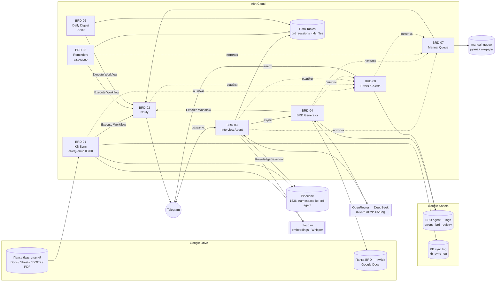

# BRD-агент на n8n: сбор требований бизнес-заказчиков → BRD в «wiki»

Заказчик пишет Telegram-боту (текстом или голосом). Агент (DeepSeek через OpenRouter) проводит структурированное интервью: задаёт по одному вопросу и сверяется с внутренней базой знаний (регламенты, стандарты, реестр действующих ИИ-сервисов). По итогам он собирает полноценный BRD по стандарту команды и публикует его как Google Doc в папке Google Drive, которая на время демо играет роль wiki. База знаний раз в сутки синхронизируется из Google Drive в Pinecone. Все ошибки пишутся в Google Sheets, а саппорт получает алерты в Telegram. Вокруг агента стоит control layer: потолки шагов, денег, времени и артефактов. Прогон, упёршийся в потолок, уходит в ручную очередь к команде, а не на перезапуск ([docs/control-layer.md](docs/control-layer.md)).

Система работает без оператора. Вы запускаете воркфлоу, заказчик сам пишет боту, а команда получает ссылку на готовый BRD.

## Архитектура



| Воркфлоу | Триггер | Назначение |
|---|---|---|
| **BRD-00** Errors & Support Alerts | Error Trigger + вызов из других воркфлоу | Пишет ошибки в лист `errors` и шлёт алерт в чат саппорта. Указан как *Error workflow* у всех остальных: ловит и необработанные падения. Одинаковые алерты подавляются на 15 минут |
| **BRD-01** Knowledge Base Sync | Ежедневно в 03:00 МСК + вручную | Находит в папке Drive новые, изменённые и удалённые файлы (по `modifiedTime`, состояние хранится в `kb_files`). Нарезает текст, считает эмбеддинги cloud.ru и делает upsert в Pinecone. Пишет журнал в `kb_sync_log`, присылает отчёт команде, при ошибках шлёт алерт саппорту |
| **BRD-02** Notify | Вызов из других воркфлоу + ручной тест | Единая точка отправки в Telegram. Адресат — `team`, `support` или `customer`; тип — `info`, `reminder`, `success`, `warning`, `alert` или `report` |
| **BRD-03** Interview Agent | Telegram (личные сообщения боту) | Интервью с заказчиком: текст или голос (Whisper), команды `/new /status /done /cancel /help`. Состояние хранится в `brd_sessions`. Когда заказчик подтверждает резюме, асинхронно запускается BRD-04 |
| **BRD-04** BRD Generator | Вызов из BRD-03 + ручной тест | Паттерн **sequential с валидатором**: писатель (агент на `deepseek-v4-pro` с инструментом KnowledgeBase) → валидатор стандарта BRD (код) → до 2 раундов исправления: пропавшую часть пишет заново писатель, остальное правит `deepseek-v4.1-flash` → публикация в Drive как Google Doc. Плохой ответ модели и технический сбой — разные ветки. Загрузка без слепого повтора: перед повтором документ ищется по `appProperties`. Каждый прогон пишется в `brd_runs` с фактической ценой ([docs/pattern-and-economics.md](docs/pattern-and-economics.md)) |
| **BRD-05** Reminders | Каждый час | Если заказчик не отвечает больше 24 ч, бот напоминает ему последний вопрос (максимум 2 раза, только с 9:00 до 20:00). Через 72 ч беседа закрывается как `abandoned`, команда получает уведомление |
| **BRD-06** Daily Digest | Ежедневно в 09:00 МСК | Сводка команде: интервью, новые BRD, активные беседы, состояние базы знаний, ошибки за сутки |
| **BRD-07** Manual Queue | Вызов из BRD-00/03/04/05 + ручной тест | Исход любого сработавшего потолка (шаги, длина интервью, бюджет сессии, лимит ключа, таймаут, число BRD): строка в листе `manual_queue` и предупреждение команде ИИ-среды. Сессия заказчика замораживается (`needs_review`), перезапуска нет |
| **BRD-08** Approve BRD | Вручную, проверяющий AIOps | Точка контроля стадии HITL: `approve` — BRD переносится из папки проверки в wiki и заказчику уходит ссылка; `return` — заказчик получает вопросы ([docs/operations.md](docs/operations.md)) |
| **BRD-97** Eval suite | Вручную | Прогон eval-набора (13 кейсов, `eval/suite.json`) через настоящие BRD-03 и BRD-04: вердикты кодом в лист `eval_results`, регрессия «до/после» ([docs/eval-suite.md](docs/eval-suite.md)) |
| **BRD-98** Eval: seed | Вручную | Записывает 5 тестовых интервью из `eval/transcripts/` в `brd_sessions` для таблицы пяти прогонов |
| **BRD-99** Setup | Вручную, один раз | Создаёт Data Tables `brd_sessions` и `kb_files` |

### Ключевые решения

- **Стандарт BRD и правила интервью** взяты из скилла `mlops-deployment-intake-v2`: [шаблон](templates/brd_template.md), [промпт интервьюера](prompts/interview_system.md), [промпт генератора BRD](prompts/brd_writer_system.md). Правила такие: один вопрос за ход; не приписывать заказчику свои оценки; закрытый контур; гейты MLflow и GitLab не блокируют интервью; по ИБ только собираются факты.
- **Состояние диалога** хранится в n8n Data Tables, внешняя БД не нужна. История беседы лежит JSON-строкой в `brd_sessions.history`. Агенту передаются последние 60 реплик.
- **Окончание интервью.** Агент присылает резюме и просит подтвердить. Только после явного «да» он ставит маркер `<<BRD_READY>>`. Заказчик также может завершить интервью сам командой `/done`.
- **BRD в «wiki».** Markdown конвертируется в HTML и загружается в Drive с конвертацией в Google Doc, поэтому таблицы, заголовки и чек-боксы остаются читаемыми.
- **Индексация без простоя.** ID фрагментов детерминированные (`<fileId>#0000`): upsert перезаписывает старые фрагменты, лишний «хвост» удаляется. Если обработка файла упала, старые фрагменты остаются в индексе, а файл будет обработан повторно при следующем запуске.
- **Паттерн и модель на шаг.** BRD-04 — sequential pipeline с валидатором: правила стандарта BRD проверяются кодом между шагами, исправляются только разделы с нарушениями, исправление одно. Писатель — сильная модель, исправление — лёгкая, проверка — код. Стоимость успешного результата считается по пяти прогонам ([docs/pattern-and-economics.md](docs/pattern-and-economics.md)).
- **Control layer.** Шаги: `maxIterations` 4 за реплику интервью и 6 за часть BRD, не больше 40 ответов в интервью. Деньги: лимит ключа OpenRouter $5 в неделю и бюджет сессии $1 (оценка в `brd_sessions.cost_usd`). Время: таймаут интервью 180 с (максимум тарифа n8n Cloud) и сторож генерации в BRD-05 (20 минут). Артефакты: 2 попытки генерации на сессию, 2 BRD на заказчика и 5 BRD всего за 24 ч. Числа обоснованы паспортом инструмента в [docs/control-layer.md](docs/control-layer.md), проверка — [docs/cost-attack.md](docs/cost-attack.md). Агентная нода n8n при `maxIterations` «успешно» возвращает текст `Agent stopped due to max iterations.`: этот текст перехватывается и заказчику не уходит, а в n8n прогон помечается `outcome = limit_stopped`.
- **Ошибки** обрабатываются на двух уровнях. Ожидаемые сбои (STT, LLM, Drive, Pinecone, Telegram, Data Table) ловятся в самом воркфлоу (`On Error → error output`): заказчик получает вежливое сообщение, ошибка уходит в BRD-00. Всё непредвиденное ловит Error Trigger в BRD-00.

## Структура репозитория

```
course-project/
├── workflows/            # сгенерированные воркфлоу n8n (с плейсхолдерами)
├── scripts/
│   ├── build_workflows.py  # генератор workflows/*.json
│   ├── check_workflows.py  # проверка JSON: связи, JS в Code-узлах, плейсхолдеры
│   ├── deploy.py           # заливка в n8n через Public API (+ --dry-run)
│   └── md2html.js          # Markdown → HTML (общий с узлом BRD-04)
├── prompts/              # системные промпты агентов (интервьюер, писатель, редактор-исправитель)
├── eval/                 # suite.json — eval-набор (13 кейсов); transcripts/ — тестовые интервью; results/ — выгрузки прогонов
├── templates/            # шаблон BRD
├── kb-demo/
│   ├── knowledge-base/   # демо-БЗ для загрузки в Drive (DOC-01…13)
│   ├── updates/          # новая ревизия DOC-09 для демо «изменения файла»
│   ├── eval/             # DOC-00 (реестр источников) и DOC-10 (эталонные вопросы) — НЕ класть в папку БЗ
│   └── src/              # исходники DOC-12/13 в Markdown
├── sheets-templates/     # заголовки листов Google Sheets
├── docs/
│   ├── demo-scenario.md        # сценарий демонстрации
│   ├── control-layer.md        # потолки агента, обоснование, раздел 4 паспорта
│   ├── cost-attack.md          # тест разгона и протокол фиксации
│   ├── pattern-and-economics.md # паттерн, модель на шаг, таблица пяти прогонов
│   ├── milestone-3.md          # веха 3: где что лежит по позициям 2.1–2.3, 4.2, 4.3, 5.3
│   ├── as-is.md                # раздел 5: As-Is, Парето, bottleneck
│   ├── to-be.md                # раздел 5: To-Be, KPI, оставленное человеку
│   ├── improvement-log.md      # расхождения с частью 1
│   ├── Раздел 5 паспорта.xlsx  # то же для сдачи (as-is/to-be/log собирает scripts/build_section5.py)
│   ├── Раздел 2 паспорта.xlsx  # часть 1 паспорта: шаги процесса и вердикты
│   ├── eval-suite.md           # раздел 6: eval-набор, регрессия «до/после», мониторинг
│   ├── operations.md           # раздел 7: риск-реестр, rollout shadow → HITL → autonomous, план эксплуатации
│   ├── environment.md          # раздел 7: где живёт агент — среда с расчётом, compliance-чек, scope пилота (+ .csv)
│   ├── evidence/               # доказательства: серия пяти прогонов, выгрузка OpenRouter, вход прогона раздела 7
│   ├── upgrade-improvement-2.md # обновление установки до паттерна
│   └── upgrade-improvement-1.md # обновление установки до control layer
└── .env.example
```

## Демо-набор базы знаний

| Файл | Что это | Зачем агенту |
|---|---|---|
| DOC-01…DOC-09 (из `itmo-l8`) | Регламент вывода в ПЭ, runbook'и online и batch, стандарты MLflow и именования, политика ИБ, глоссарий и RACI, FAQ | Точные вопросы и ссылки на требования |
| DOC-11 Реестр действующих ИИ-сервисов (CSV → Google Sheet) | 12 синтетических сервисов | Проверка на дубли: «такой сервис уже есть» |
| DOC-12 Стандарт BRD | Правила и шаблон BRD | Генератор ссылается на стандарт |
| DOC-13 Пример согласованного BRD | Заполненный BRD (SRV-004) | Образец уровня детализации |
| `updates/DOC-09…` | FAQ ревизии 42 с новым разделом «8. Вопросы по BRD» | Показать переиндексацию изменённого файла |

## Установка

### 1. Внешние сервисы

1. **Telegram.** Создайте бота в @BotFather. Создайте две группы, «Команда ИИ-среды» и «Саппорт BRD-агента», и добавьте в них бота. Чтобы узнать ID группы, напишите в неё сообщение и откройте `https://api.telegram.org/bot<TOKEN>/getUpdates`: нужное значение — `chat.id`, обычно вида `-100…`.
2. **Pinecone.** Подойдёт существующий индекс `itmo-l8-1536` (1536, cosine) с отдельным namespace `kb-brd-agent`, либо создайте новый с теми же параметрами. Скопируйте *host* индекса.
3. **cloud.ru Foundation Models.** Нужен ключ API (используются `openai/text-embedding-3-small` и `openai/whisper-large-v3`).
4. **OpenRouter.** Пополните баланс и создайте ключ с лимитом **$5, сброс раз в неделю**. Это денежный потолок агента, см. [docs/upgrade-improvement-1.md](docs/upgrade-improvement-1.md#шаг-1-ключ-openrouter-с-лимитом). Модель: `deepseek/deepseek-v4.1-flash`.
5. **Google Drive.** Создайте две папки: «BRD Knowledge Base» и «BRD Wiki». Для демо удобно открыть доступ к папке BRD Wiki по ссылке на чтение — тогда заказчики без доступа к вашему Drive смогут открыть документ.
6. **Google Sheets.** Создайте две таблицы:
   - «BRD agent — logs» с листами `errors`, `brd_registry`, `manual_queue` и `brd_runs`;
   - «KB sync log» с листом `kb_sync_log`.

   В первую строку каждого листа вставьте заголовки из `sheets-templates/*.csv`: имя файла означает «таблица__лист». Без заголовков запись в Sheets падает с ошибкой `Could not retrieve the column data`.

### 2. Загрузка базы знаний

Загрузите в папку «BRD Knowledge Base» всё содержимое `kb-demo/knowledge-base/`. Конвертировать DOCX в Google Docs заранее не обязательно: BRD-01 сам создаёт временную Google-копию и экспортирует из неё текст. Если хотите, чтобы документы были «живыми» Google Docs, включите в Drive *Настройки → Преобразовывать загружаемые файлы*. Файлы из `kb-demo/eval/` в папку не кладите: в DOC-10 эталонные ответы для оценки RAG.

### 3. n8n Cloud

1. **Credentials** (*Overview → Credentials → Create*):

   | Credential | Тип в n8n | Настройка |
   |---|---|---|
   | Telegram BRD bot | Telegram API | токен бота |
   | Google Drive OAuth2 | Google Drive OAuth2 API | *Sign in with Google* |
   | Google Sheets OAuth2 | Google Sheets OAuth2 API | *Sign in with Google* |
   | OpenRouter (key with limit) | OpenRouter | ключ OpenRouter с лимитом (без `Bearer`) |
   | OpenRouter API key (header) | Header Auth | Name `Authorization`, Value `Bearer <ключ OpenRouter>` |
   | cloud.ru (OpenAI-compatible) | OpenAI | ключ cloud.ru, Base URL `https://foundation-models.api.cloud.ru/v1` |
   | Pinecone | Pinecone API | ключ |
   | Pinecone API key (header) | Header Auth | Name `Api-Key`, Value — ключ Pinecone |
   | cloud.ru API key (header) | Header Auth | Name `Authorization`, Value `Bearer <ключ>` |

   > Для Google нужен именно **OAuth2**, а не Service Account: у сервисного аккаунта нет своей квоты в Drive, поэтому создавать BRD-документы в обычной папке он не сможет.
   >
   > **Для Google Drive нужен собственный OAuth-клиент.** Если подключить Drive кнопкой «Sign in with Google» (через OAuth-приложение n8n Cloud), credential будет работать только в штатных узлах Drive. В HTTP Request она запрещена, а BRD-01 (конвертация DOCX) и BRD-04 (публикация Google Doc) используют именно HTTP Request. Порядок настройки:
   > 1. console.cloud.google.com → новый проект → включить **Google Drive API**.
   > 2. *Google Auth Platform → Audience*: тип External, свой email в **Test users** (иначе будет `403 access_denied`).
   > 3. *Clients → Create client* → тип *Web application* → в *Authorized redirect URIs* указать `https://oauth.n8n.cloud/oauth2/callback` (иначе будет `redirect_uri_mismatch`).
   > 4. В n8n создать credential *Google Drive OAuth2 API* с Client ID и Secret этого клиента → **Connect my account** → дождаться надписи «Account connected». Если вместо неё ошибка `Unable to sign without access token`, значит, вход не выполнен.
   >
   > Для Google Sheets достаточно «Sign in with Google»: эта credential используется только в штатных узлах.
2. **API-ключ** создаётся в *Settings → n8n API*.
3. **Деплой:**
   ```bash
   cp .env.example .env
   ```
   Заполните `.env`: ID папок, таблиц и чатов, параметры Pinecone и ID credentials (их видно в URL открытой credential). Затем выполните:
   ```bash
   python3 scripts/deploy.py
   ```
   Скрипт создаст 10 воркфлоу в нужном порядке и подставит связи между ними (Execute Workflow, Error workflow). Повторный запуск обновит одноимённые воркфлоу.

   **Без API** (на пробном периоде n8n Cloud Public API недоступен):
   1. Создайте в n8n четыре пустых воркфлоу — BRD-00, BRD-02, BRD-07, BRD-04 — и впишите их ID из URL в `.env` (`WF_ERRORS_ID`, `WF_NOTIFY_ID`, `WF_QUEUE_ID`, `WF_BRD_GENERATOR_ID`).
   2. Выполните `python3 scripts/deploy.py --dry-run`: в `build/*.json` подставятся конфигурация и связи между воркфлоу.
   3. Импортируйте BRD-00/02/07/04 в созданные воркфлоу (**⋯ → Import from File**), а остальные — в новые.
   4. Выберите credentials и **опубликуйте** BRD-00, 02, 07 и 04 (**Publish**). В n8n 2.x Error workflow и Execute Workflow работают только с опубликованными воркфлоу. После каждой правки подворкфлоу публикуйте его заново.
   5. В BRD-01…07 выберите **Settings → Error workflow → BRD-00**. В BRD-03 включите **Settings → Timeout Workflow: 3 минуты**. В BRD-04 таймаут не ставьте: тариф разрешает максимум 3 минуты, а генерация идёт 3–5 минут.
4. Один раз запустите **BRD-99 Setup**: он создаст Data Tables.
5. Запустите **BRD-02 → Manual test**: в чат команды должно прийти тестовое сообщение.
6. Запустите **BRD-01 → Manual run**: в Pinecone появятся фрагменты, в `kb_sync_log` — строки, в чат команды придёт отчёт.
7. Активируйте **BRD-01, BRD-03, BRD-05 и BRD-06**. Можно сразу: `python3 scripts/deploy.py --activate`.

### Изменение промптов или логики

Правьте `prompts/*.md`, `templates/brd_template.md` или `scripts/build_workflows.py`, затем выполните:

```bash
python3 scripts/build_workflows.py
```

```bash
python3 scripts/check_workflows.py
```

```bash
python3 scripts/deploy.py
```

Потолки control layer меняются в одном месте: `LIMITS` в `scripts/build_workflows.py`. Если меняете число, обновите и его обоснование в `docs/control-layer.md`.

Правки, сделанные прямо в UI n8n, при следующем деплое перезапишутся. Переносите их в генератор.

## Демонстрация

Пошаговый сценарий с репликами заказчика и ожидаемым поведением — в [docs/demo-scenario.md](docs/demo-scenario.md).

## Ограничения и что учесть

- **Google Sheets в базе знаний:** Drive экспортирует только *первый лист* таблицы.
- **Временные копии DOCX и XLSX** называются `_tmp_convert_*` и удаляются сразу после экспорта. Если удаление не удалось, файл исключается регулярным выражением `KB_EXCLUDE_REGEX` и не индексируется.
- **Параллельные сообщения.** Если заказчик отправит несколько сообщений за секунду, ответы могут обработаться параллельно, и в истории сохранится последнее. Для демо это некритично. В проде нужна очередь или блокировка по `chat_id`.
- **Длина BRD.** Ответ модели ограничен `maxTokens = 8000`, поэтому BRD пишется в три приёма: разделы 0–5, 6–7 и 8–12.
- **Оценка расхода сессии** (`cost_usd`) считается внутри сценария по длине текста (2 символа на токен, откалибровано в cost-attack) и по цене из `.env`. Это оценка сверху, а не счёт. Фактический расход и жёсткий денежный потолок — у ключа OpenRouter. При смене модели меняйте и `CFG_LLM_PRICE_*`.
- **Лимит executions на n8n Cloud.** BRD-05 даёт около 720 запусков в месяц, BRD-03 — один запуск на каждое сообщение. Если тариф Starter, уменьшите частоту BRD-05 (cron в узле *Every hour*).
- **Эксплуатация.** `CFG_MAINTENANCE=true` — kill-switch: бот отвечает «временно недоступен», модель не вызывается. `CFG_ROLLOUT_STAGE` = `shadow` / `hitl` / `autonomous` — стадия rollout: на shadow и hitl BRD уходит в папку проверки `CFG_REVIEW_FOLDER_ID`, на hitl заказчик получает ссылку только после BRD-08. Критерии переходов и условия отката — [docs/operations.md](docs/operations.md).
- **Scope пилота кодом.** `CFG_ALLOWED_CHAT_IDS` — chat_id разрешённых заказчиков через запятую: остальным бот отвечает отказом, не распознавая голос и не вызывая модель. Пусто — бот открыт всем (демо). Среда для пилота и прода — внутренний контур ([docs/environment.md](docs/environment.md)).
- **Мониторинг самого n8n.** Если недоступен весь инстанс, BRD-00 не сработает. Для прода стоит добавить внешний uptime-чек, например на webhook-воркфлоу.
- **Закрытый контур.** В демо используются облачные OpenRouter/DeepSeek, cloud.ru, Pinecone и Google. Для реального банковского контура их нужно заменить на on-prem: LLM в OpenShift, pgvector или Qdrant, Confluence. Структура воркфлоу при этом не меняется. Денежный потолок в контуре переедет с ключа OpenRouter на бюджет шлюза (например, LiteLLM перед on-prem моделью).

## «Wiki»: что ещё можно вместо Google Drive

Для демо используется Google Docs: ноль настройки, комментарии и история версий из коробки. Если понадобится настоящая wiki, публикацию в BRD-04 можно поменять на:

- **Confluence** — `POST /wiki/rest/api/content` с HTML в формате storage, подходит под тот же `md2html`. Это стандарт для банковских команд.
- **Notion** — в n8n есть штатный узел, страница собирается из блоков.
- **Outline / Wiki.js / GitLab Wiki** — есть REST API, принимают Markdown напрямую.
